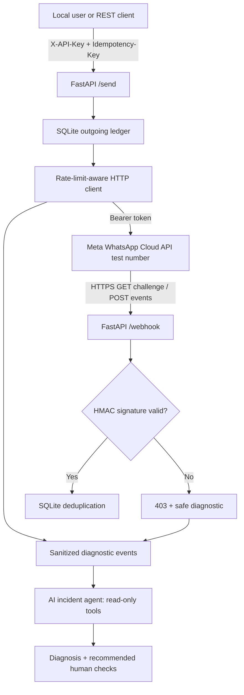

# Meta WhatsApp Cloud API + AI Integration Diagnostics

> **Portfolio / learning project.** A small Python integration against Meta's WhatsApp Cloud API **test number**, with a secure webhook receiver, local idempotency, bounded rate-limit retries, structured *sanitized* diagnostics, and a **read-only LLM agent** that uses real function calls to investigate failures.
>
> **Status:** Unit/integration tests use simulated Meta responses; live Meta and OpenAI access requires **your own** developer test credentials. No business approval, message sending, or LLM run is claimed here.

  

## Why this project

Show that you can build a production-minded external integration instead of only making a successful `requests.post()` call. The difficult parts are **authentication**, **authentic webhook events**, **duplicate deliveries**, **rate limits**, **ambiguous failures**, **testing** and **safe AI diagnostics**.

### What is implemented

- ✅ **Outbound authentication:** Meta Bearer token on `POST /{PHONE_NUMBER_ID}/messages`; separate internal `X-API-Key` on our `/send` endpoint.
- ✅ **Webhook verification:** Meta's `GET /webhook` challenge; `POST /webhook` verifies `X-Hub-Signature-256` using the **exact raw request bytes** and constant-time HMAC SHA-256 comparison.
- ✅ **Idempotency:** SQLite unique idempotency keys to avoid duplicate local sends from repeat HTTP requests; HMAC pseudonyms to dedupe inbound webhook events.
- ✅ **Retries:** bounded exponential backoff for explicitly rejected 429/rate-limit responses and connection-establishment failures. Respects small `Retry-After` periods, with safe refusal to retry when the server asks for a longer wait than the local configured maximum.
- ✅ **Honest handling of uncertain outcomes:** 5xx, read timeouts and broken responses may mean the send reached Meta; the record is held in `uncertain` state for human reconciliation, **not automatically resent**.
- ✅ **Read-only LLM agent:** OpenAI Responses API *function calls* expose only `get_recent_errors`, `count_error_codes`, and `get_runbook`. Tools read whitelisted diagnostic fields and never access phone numbers, chat content or secrets.
- ✅ **Tests:** local HTTP mocking; runs without Meta or OpenAI credentials.

## Architecture



See [Architecture and design decisions](docs/architecture.md).

## Quickstart (Windows PowerShell)

**Prerequisites:** Python 3.11+, Git, a Meta developer account, and optional `ngrok` for public HTTPS webhooks. The offline tests work immediately without Meta access.

```powershell
# 1. Clone your own copy of this project; OR unzip the provided starter.
cd meta-whatsapp-ai-diagnostics

# 2. Isolate Python dependencies.
py -3 -m venv .venv
.\.venv\Scripts\Activate.ps1
python -m pip install -e ".[dev]"

# 3. Make your private local configuration.
Copy-Item .env.example .env
# Edit .env in VS Code and replace all placeholder tokens / numbers.

# 4. Run tests (no external API calls).
python -m pytest -q

# 5. Start server.
uvicorn app.api:create_app --factory --reload --port 8000
```

Linux/macOS: `python3 -m venv .venv`, `source .venv/bin/activate`, `cp .env.example .env`; then use the same `pip`, `pytest` and `uvicorn` commands.

Open **http://127.0.0.1:8000/docs** for the automatically generated API docs. `GET /health` reports `{"status":"ok"}`.

### Meta sandbox setup (checked 26 October 2026)

1. Visit **[Meta for Developers](https://developers.facebook.com/)**. Create a developer app and add the **WhatsApp** product, following the Meta dashboard's current onboarding flow. The official [WhatsApp Business Developer Hub](https://whatsappbusiness.com/developers/developer-hub/) confirms the availability of test numbers, webhooks and a sandbox.
2. In the WhatsApp API testing/getting-started area, obtain the **temporary access token**, the **test phone number ID**, and register/verify **your own recipient number** as a permitted test destination. Meta's sandbox recipients are limited; use only your own opted-in numbers.
3. Find the **App Secret** under the app's basic settings. Store it as `META_APP_SECRET`. Choose a **different, random** `WEBHOOK_VERIFY_TOKEN`. Store the Meta token as `META_ACCESS_TOKEN`, and the sender's phone number ID as `META_PHONE_NUMBER_ID`.
4. Set `ALLOWED_TEST_RECIPIENTS` to the verified recipient's digits (country code included, no `+`). Choose a long random `INTERNAL_API_KEY`. Use `GRAPH_VERSION=v26.0` (the current Graph API version when checked), but always verify your actual app/API support in Meta's current dashboard.
5. To receive actual webhooks, expose your local server using an HTTPS tunnel: `ngrok http 8000`. In the Meta webhook dashboard set the callback URL to `https://YOUR-TUNNEL.ngrok-free.app/webhook` and the verification token to the value in `.env`, and subscribe to the **messages** field.
6. Send a WhatsApp message from the verified recipient to the Meta test number to exercise inbound webhooks and, when permitted, open the normal customer-service conversation window for a text reply. Free-form outbound texts can be restricted outside the service window; Meta's provided approved test template is another path for an initial test, but **this sample sends plain text**, not templates.

**Account-specific access isn't verified by this repository.** Test assets, menus, verification requirements, messaging policies and quotas may change; the Meta dashboard is authoritative for your account.

**Important tunnel warning:** a tunnel forwards the app's *entire* HTTP API, including `/send` and `/docs`, not just `/webhook`. This example protects `/send` with a separate local API key and allowlist, but the development server is **not production-ready**. Never publish credentials; do not keep a tunnel active unnecessarily.

### Send a message to your verified test recipient

With the server running, in PowerShell:

```powershell
$headers = @{
  "X-API-Key" = "YOUR_INTERNAL_API_KEY_FROM_DOT_ENV"
  "Idempotency-Key" = "my-first-test-001"
}
$body = @{ recipient = "YOUR_VERIFIED_DIGITS"; text = "Hello from my API demo" } | ConvertTo-Json
Invoke-RestMethod -Uri "http://127.0.0.1:8000/send" -Method Post -Headers $headers -Body $body -ContentType "application/json"
```

Or in a POSIX shell:

```bash
curl -sS -X POST http://127.0.0.1:8000/send \
  -H "Content-Type: application/json" \
  -H "X-API-Key: YOUR_INTERNAL_API_KEY_FROM_DOT_ENV" \
  -H "Idempotency-Key: my-first-test-001" \
  -d '{"recipient":"YOUR_VERIFIED_DIGITS","text":"Hello from my API demo"}'
```

Send **exactly the same request with the same key** a second time: the service returns `"cached":true` and does not make another Meta API request. Reuse the key with a *different* recipient or text: the service returns HTTP **409 Conflict**.

A successful API response contains a Meta message ID, **not proof of recipient delivery**. Status webhooks are how Meta reports later delivery states; this sample records them as pseudonymous events rather than maintaining a full delivery-state model.

## Agent quickstart (no Meta calls required)

First, generate intentionally artificial incidents:

```bash
python -m app.seed_demo
python -m app.agent --offline
```

This generates a deterministic rule-based report using vetted runbook entries; it proves the database and diagnostic path work even if you do not yet have API keys.

For a **real LLM tool-calling session**, obtain an OpenAI API key, place it in your **private** `.env` as `OPENAI_API_KEY=...` and run:

```bash
python -m app.agent
```

The agent makes OpenAI API requests (**possible usage charges**) and uses these functions:

| Tool | Purpose | Data it may read |
|---|---|---|
| `get_recent_errors(limit)` | Find recent failures | Timestamp, event type, code, safe hint, attempt |
| `count_error_codes()` | Identify common failure types | Error code and count |
| `get_runbook(code)` | Retrieve a vetted remedy | Static remediation text |

It has **no tools for sending messages, executing commands, reading arbitrary files or editing records**. Output is advice for human review, not an automated repair action. The agent is bounded to 4 model rounds and 8 tool calls.

OpenAI tool-calling reference: https://developers.openai.com/api/docs/guides/function-calling

## Troubleshooting

| Symptom | Likely reason | Check |
|---|---|---|
| `GET /webhook` returns 403 | Wrong `hub.verify_token` or mode | Meta callback token must exactly equal `WEBHOOK_VERIFY_TOKEN` |
| `POST /webhook` returns 403 | Wrong App Secret/signature or modified body | Validate app secret and tunnel; signature covers the **raw** POST bytes |
| `/send` returns 401 | Missing/wrong `X-API-Key` | Use `INTERNAL_API_KEY`; this is **not** Meta's access token |
| `/send` returns 403 | Destination not in allowlist | Add your own verified test recipient to `.env` |
| Meta code `190` | Expired/invalid Meta access token | Obtain a new test token; check permissions and expiration |
| Meta code `131030` | Recipient not allowed | Add and verify the recipient in Meta's test setup |
| Meta code `131047` | Outside service conversation window | Use an appropriate approved template; the demo currently sends free-form text |
| Meta code `130429` or HTTP 429 | Rate-limited | Reduce throughput, honor `Retry-After`, retry the **same** idempotency key after backoff |
| `/send` returns `uncertain` | Network/Meta response may have accepted send | **Don't blindly resend**; reconcile status in Meta/dashboard/webhooks |
| OpenAI error | No API key/model access/billing | Start with `python -m app.agent --offline` and check available API models |

The test endpoint uses a **temporary token**, which expires. Meta's full production access/permissions flow is separate and not part of this demonstration.

## Test suite

```bash
python -m pytest -q
```

Covers: valid/invalid webhook HMAC, exact raw-body signature, verification challenge, webhook duplicate suppression, authentication, recipient allowlisting, outgoing idempotency and conflicting keys, rate-limit retries, unknown-outcome safety, retry after rate-limit exhaustion, and read-only agent tool boundaries. HTTP tests use `httpx.MockTransport` so **no Meta messages are sent**.

Run CI on GitHub Actions via `.github/workflows/ci.yml` (no secrets needed).

## Responsible AI

**Data minimisation:** The agent sees only allowlisted metadata: timestamp, operation type, sanitized error code, static explanation, retry number. **Never** pass chat text, phone numbers, complete webhook payloads, app secrets, bearer tokens, or arbitrary exception bodies to a model. Incoming event identifiers are HMAC pseudonyms before SQLite storage. The outbound ledger does store Meta message IDs and payload fingerprints locally and must remain private.

**Human review:** LLM outputs are fallible and can misclassify errors. The model cannot apply fixes, access private credentials or send WhatsApp messages. Any change to tokens, rate limits, production settings or ambiguous-delivery status requires a human. Tool results are treated as untrusted data; the agent is instructed not to obey instructions embedded in logs.

**Evaluation:** Use the synthetic, de-identified examples in [`samples/eval_cases.jsonl`](samples/eval_cases.jsonl) and the process in [`docs/evaluation.md`](docs/evaluation.md). Assess code identification, safety of proposed actions, hallucinations, and refusal to expose or act on PII. Don't upload production logs into the evaluation set.

**Retention:** For a real deployment, add a configurable retention/delete process, permissions on the SQLite file, encryption at rest, access reviews, and applicable data processing notices. The current sample does **not** implement automatic retention/deletion.

## Design choices and limitations

- **Local SQLite idempotency does NOT make Meta delivery exactly-once.** Meta's send API is not assumed to accept a universally effective idempotency key. Application keys prevent duplicate *local* sends after success; a timeout or 5xx can be ambiguous, so requests are locked for manual investigation.
- Incoming HMAC validates source integrity, not freshness. HMAC-based event deduplication reduces replay effects for the same event ID, but this is not a general replay-prevention guarantee.
- SQLite is a good single-node demonstration, not a distributed production message queue. Add an outbox/worker, locks/leases, metrics and dead-letter processing for a real multi-instance system.
- No automatic status-to-outbound correlation is implemented; it would be a useful next iteration.
- Meta's rate limits and test-account requirements can change; do not hard-code assumptions about an individual account.
- Use only authorised test recipients who opted in, and follow WhatsApp messaging rules.

## Suggested 4-day build and learning plan

| Day | Goal | Explain it in an interview |
|---|---|---|
| **1** | Create Meta sandbox, run FastAPI, configure bearer token and signed handshake | Authentication vs authorisation, HTTP and Meta Graph API |
| **2** | Implement webhook HMAC, dedupe, SQLite idempotency | Why raw body, replayed webhooks, exactly-once limitations |
| **3** | Implement 429 backoff, ambiguous-error handling and automated tests | Transient vs permanent errors, retry safety, deterministic mocks |
| **4** | Add the tool-calling agent, synthetic evaluation, responsible-AI safeguards, polish README | Tool-calling loop, least privilege, prompt injection, human approval |

## Repo layout

```text
app/
  api.py           # FastAPI health, Meta webhook, protected /send
  config.py        # Private environment settings
  db.py            # SQLite idempotency + sanitized diagnostics
  security.py      # HMAC signature checks + pseudonymous IDs
  meta.py          # Meta Graph API client and bounded retries
  agent.py         # LLM tool calling + offline read-only report
  seed_demo.py     # Non-network synthetic incidents
tests/              # Local HTTP mocks and security coverage
docs/architecture.md
/docs/evaluation.md
samples/eval_cases.jsonl
.github/workflows/ci.yml
Dockerfile
```

**Recommended GitHub repo name:** `meta-whatsapp-ai-integration-agent`

**Suggested one-line repo description:** "Sandbox-first WhatsApp Cloud API integration with signed webhooks, SQLite idempotency, rate-limit handling, pytest coverage and a read-only LLM troubleshooting agent."

---

Built as a learning-focused software engineering portfolio project; not an official Meta or OpenAI product.
