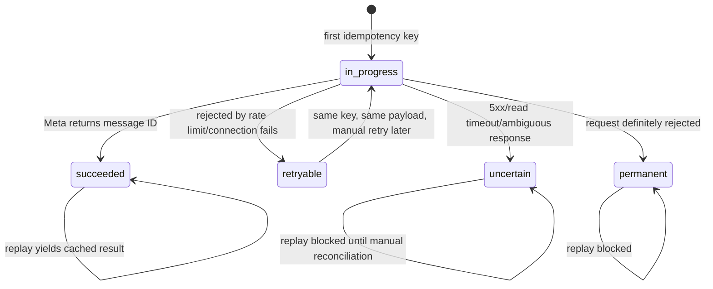

# Architecture, reliability choices and threat model

## Components

- **FastAPI:** receives HTTP requests, applies input validation and authentication.
- **MetaClient:** generates the correct Graph API URL, uses a Meta bearer token, classifies responses and retries *only selected* cases.
- **Ledger (SQLite):** enforces unique outbound idempotency keys and unique, pseudonymised webhook event IDs; retains curated error metadata.
- **Incident agent:** uses OpenAI Responses API function calls with a fixed allowlist of read-only tools.

## Why this form of authentication?

Meta's `Authorization: Bearer` identifies our developer app to Meta. The local `X-API-Key` is a separate credential protecting our outbound test endpoint from unauthorised callers. Meta's webhook `GET` verification uses a deliberately chosen shared verification token; webhook `POST` integrity uses the Meta app secret to compute HMAC over raw bytes. These values are **not interchangeable**.

## Outbound request state machine

One idempotency key must always correspond to exactly one recipient+message fingerprint. If a client reuses a key for different content the server returns 409. Keys persist across restarts. A process crash might leave a record in `in_progress`; it is **not** automatically retried because the request may have reached Meta.

### Retry categories

| Failure | Default choice | Why |
|---|---|---|
| HTTP 429, Meta rate limit code | Retry with bounded backoff | Request was explicitly rejected as rate-limited |
| ConnectError/ConnectTimeout | Retry bounded | No successful HTTP connection established |
| HTTP 400/401/403 non-rate-limit | No retry | Invalid request or permissions; fix configuration |
| HTTP 5xx | Mark uncertain and stop | Non-idempotent POST might already have been processed |
| ReadTimeout, WriteTimeout, dropped connection after request | Mark uncertain and stop | No safe evidence of non-delivery |

Backoff is exponential. A larger `Retry-After` than configured max prevents same-call retry instead of violating Meta's requested wait. The caller can retry later with the same key while record status is `retryable`.

## Webhook trust boundaries

1. Read **raw** signed bytes (max 1 MiB).
2. Verify `X-Hub-Signature-256=sha256=<hex>` using `HMAC_SHA256(app_secret, raw_bytes)` with constant-time comparison.
3. Decode JSON *only after* signature verification.
4. Extract event IDs for incoming `messages` and `statuses`; HMAC pseudonymise before writing to the database.
5. Duplicate event IDs are ignored. No raw message body is saved or passed to AI.

Caveat: the webhook's HMAC is not by itself a timestamp-based anti-replay protocol. An identical signed payload is deduplicated by event ID; altered distinct signed events cannot be forged without the app secret.

## Agent threat model

Potential risk: accidental leak of WhatsApp text or phone numbers into LLM context, prompt-injection text in logs, AI suggesting destructive remediations, or high API costs. Mitigations: only store an allowlist of diagnostic fields, tool functions query only those fields, stable runbook text, no generic shell/SQL/HTTP tools, no write tools, bounded model turns/tool calls, no autonomous repairs, no model access to `.env`, model requests use `store=False` and human reviews any recommendation.

For production: database IAM and encryption, log redaction auditing, retention/purge jobs, queue/worker/outbox, alerting, external API credential rotation, optional OAuth for clients, monitoring, sandbox/prod separation and compliance review.
